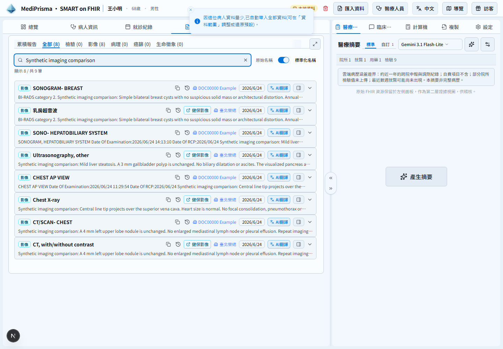
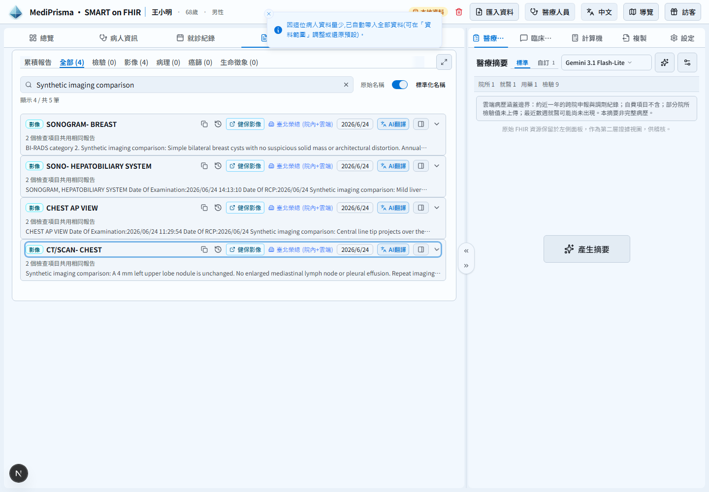
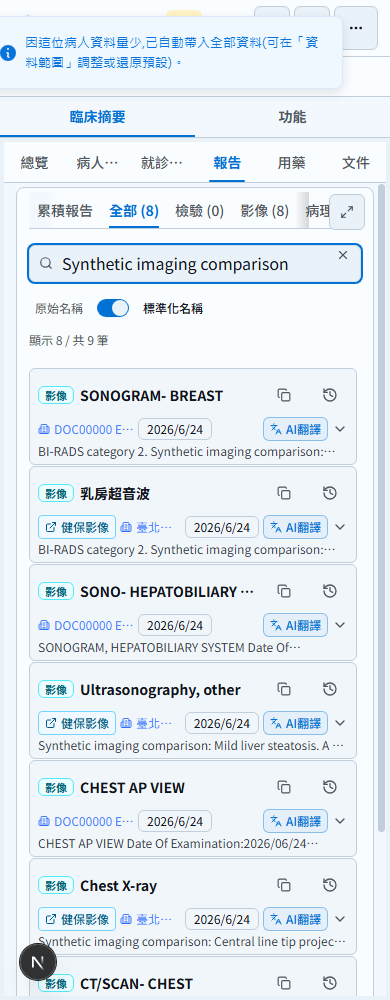
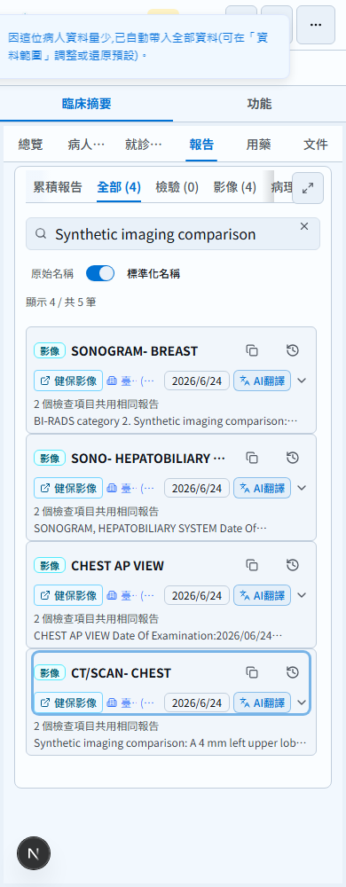

# Imaging report copy grouping evidence

All records, report text, identifiers and viewer responses in these screenshots are synthetic. No patient export or authenticated NHI response is included.

Before: `cb25ef88e40c75548ef2d9c6ef8fe60f3880860b` (PR base, including the import Worker, medication-source and original-download filename changes).
After application code: `510fbbb0ed567047864a8b89cf823a6014eac58d` (latest master integrated; safe dictation spacing, mixed-channel narratives, interval bounds and all distinct source assets preserved). The following evidence-only commit does not change application code.

Both isolated checkouts ran `e2e/tests/reports-cross-source-imaging.spec.ts` with the same generated bundle, locale, light theme, collapsed report rows, search and viewport. Before uses `IMAGING_BEFORE=1`; assertions expect eight rows before and four groups after. Six widths passed: 320, 390, 430, 768, 1024 and 1440 CSS pixels, height 1000.

One prior NHI report remains outside the search, so the filtered display is 8/9 before and 4/5 after. Searching the NHI breast-ultrasound title still finds the merged row. Each original title has its own history action; opening the NHI source history displays its prior report without inferring aliases across body parts.

Both source history actions are verified in the browser. In-house history shows the known Taipei VGH institution rather than a legacy DOC physician label; original physician data remains in the imported FHIR resources. The positive and negative assertions target the visible history panel, excluding retained hidden raw-data views.

Both conclusion-based and attachment-only browser variants pass. Set `IMAGING_TEXT_ATTACHMENTS=1` for the latter: breast report bodies and prior history exist only in base64 text/plain attachments. History retains those attachments and uses the source examination day, including effectivePeriod and UTC-to-Taiwan day boundaries (also tested under UTC). Existing conclusions, notes and non-imaging date rendering are preserved.

| Before | After |
| --- | --- |
|  |  |
|  |  |

[Original source narratives and IDs](after-sources.png) remain available. [Viewer result](after-viewer.png) uses an intercepted synthetic HTTPS page and a simulated NHI extension bridge. The actual application request retains `SYNTHETIC-0` and its synthetic patient context hash. This verifies application wiring, not an authenticated live NHI session.

The regression suite executes production grouping and UI/AI paths, including conflicting body text, side/anatomy/modality/contrast/view, dates/times, patient/facility/status/identifiers, repeated exams, incomplete attachments, structured results, filtered views, existing shared procedure groups and echo exclusions. Uncertain evidence stays separate; source FHIR resources are never deleted.

Study-linked reports (including unresolved, identifier-only and same-reference links) stay outside automatic cross-source pairing until study identity is verified. Clinical superscripts, subscripts, micro symbols and unit case remain distinct; cross-source pairing folds only full-width ASCII formatting and whitespace. Natural imaging copies also recognize explicit capitalized dictation word boundaries and punctuation spacing without erasing token boundaries or case.

Explicit period-end conflicts and reversed/invalid intervals remain separate. Equivalent end instants across timezones can match. The natural imaging key retains the complete period; narrative representative selection preserves every source PNG, linked study, structured result and report ID. Imaging row/count comparisons share the safe clinical typography policy, while keeping original signatures and addenda in the natural grouping path. Non-imaging grouping and attachment history retain their existing behaviour.

Every known period end also constrains the other source's examination clock, even when its own start is date-only. Negative-timezone regressions keep untagged imaging period dates aligned between rows and AI context. Redundant natural-group narrative observations are skipped only when their clinical metadata is fully represented by a retained complete observation or report. Unknown assessments remain visible. Exact image descriptors collapse; different bytes, references, content types, titles or sizes remain available.

Additional integration checks: the Worker module regression passes after integrating PR #344. `merged-fhir-download.spec.ts` passed before that upstream merge. `original-fhir-download.spec.ts` timed out at the popup's Copy tab (line 78 → line 31), both on the earlier unmodified base `af0bfe42` and on the PR. This existing popup-layout test limitation is recorded separately from the passing imaging regression.

Shared identifier namespaces require complete value/type sets to match; a shared order never overrides different accession numbers. Identifier and coding array order alone is ignored. The exact same linked Observation object renders once, while different source objects remain visible even when they share an ID. Regression coverage includes the production row, count and AI paths.

History retains a conflicting explicit institution and leaves malformed provenance unlabelled; normal DOC physician sources still resolve to Taipei VGH. Distinct observations sharing an ID remain visible in inline and right-pane details with unique React keys. If both sources provide identifiers without a namespace, different complete sets remain separate. AI lists every source procedure as a source report sharing the narrative, without asserting that different billing items are aliases.
