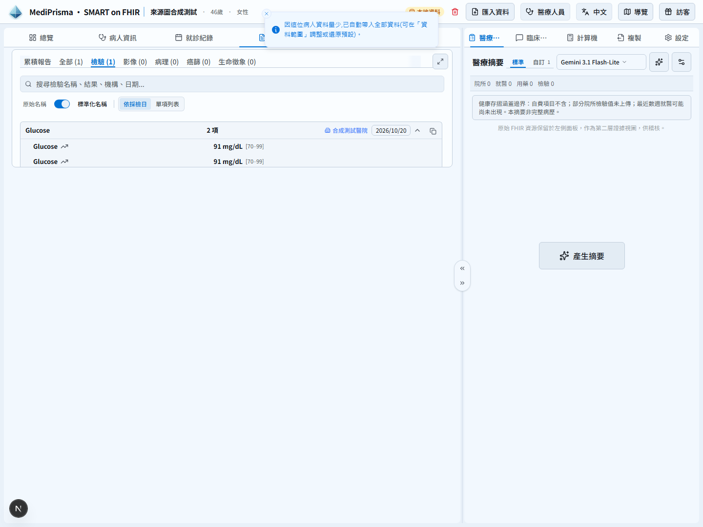
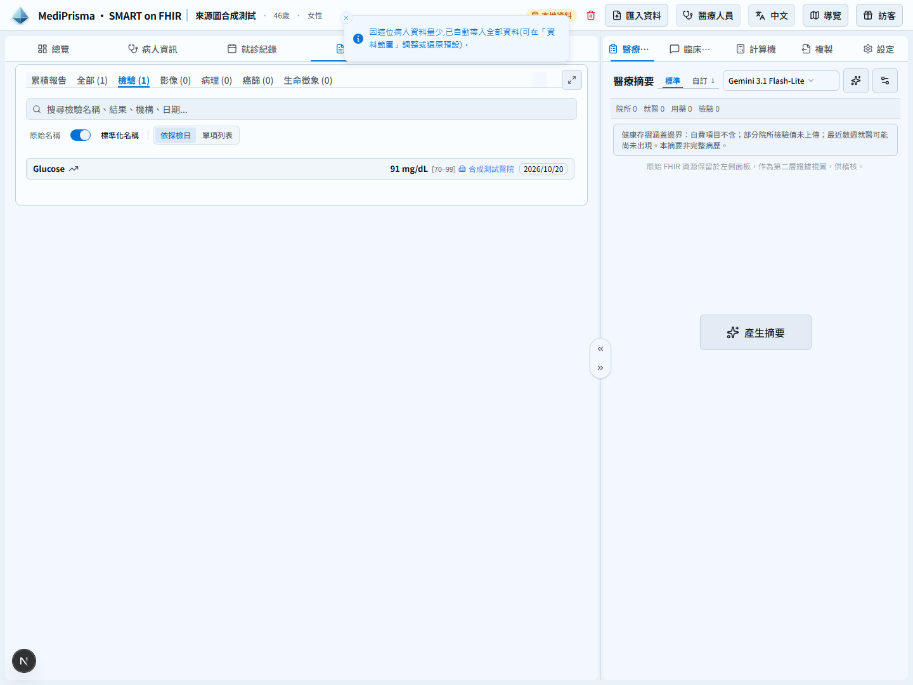
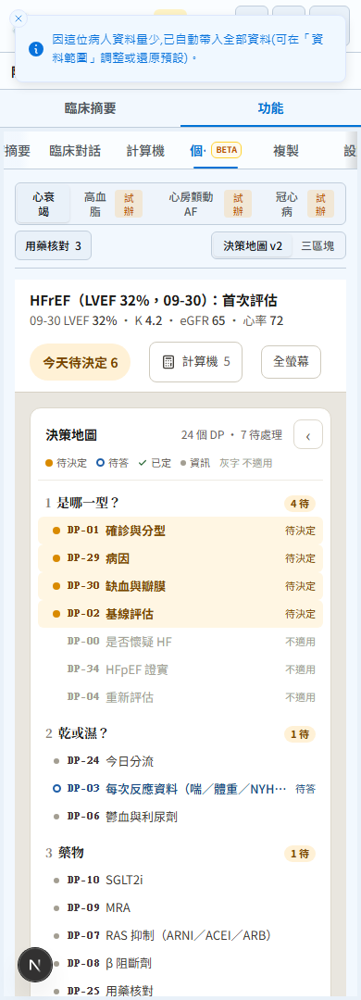
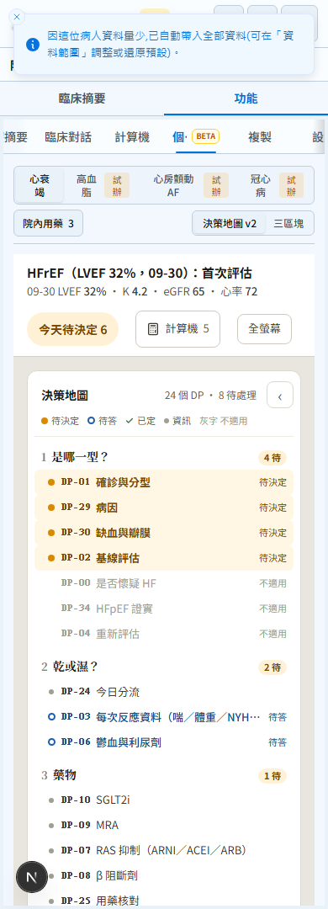
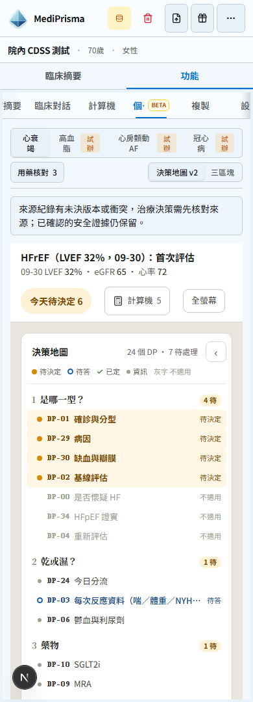
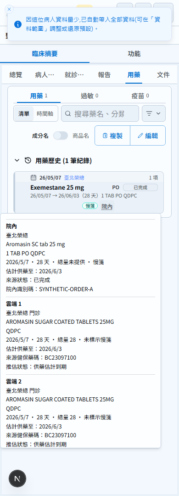
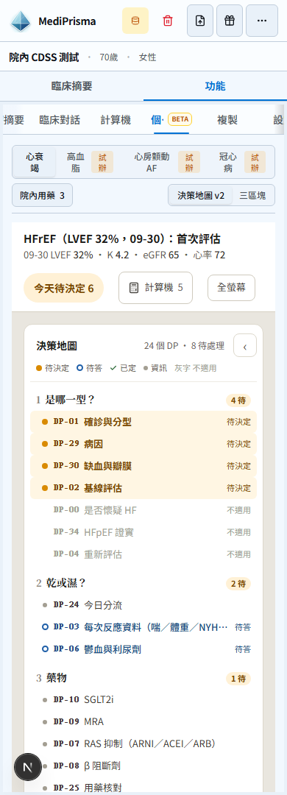

# Automatic clinical source selection — evidence

Tested code: `15d5b74e1d72ddbf66a2d8b39119a63f6d583814`.
PR base: `0c71c9cdfe62ad12473217af0be030b41b5d4c25`.
Previous PR revision before the owner policy update: `2915066354acde227b1fd314fdadd931839a58c8`.

All records are synthetic. Before and after use the same input and 1440×1080 or 390×1080 viewport, fixed date 2026-10-21T04:00:00Z. Medication and missing-content cases also pass at 320, 430, 768 and 1024 widths, without horizontal page or source-popover overflow.

| PR base | Tested code |
| --- | --- |
|  |  |
|  |  |

Additional policy comparison: the previous PR revision introduced a source-reconciliation notice; the tested code removes it and directly uses selected facts.

| Previous PR revision 29150663 | Tested code 15d5b74e |
| --- | --- |
|  |  |

Tests cover actual Local import, React Query structural sharing and progressive refetch, report/encounter/citation references, AI/CDSS input and IPS export/reimport. Different hospital orders remain distinct. One hospital order with two matched cloud copies displays once; original copies remain available. Multiple hospital orders use group-level Provenance audit evidence in IPS rather than attributing all copies to one order.

Legitimate Patient revisions are selected automatically. Different patients and unordered contradictory identity facts remain rejected; compatible identifier additions and equivalent copies of the selected version are accepted independently of entry order.

A missing drug does not become an inferred medication absence or a fabricated safe start/titrate action. Available facts remain usable without manual source-reconciliation prompts.

Review was performed independently by OpenAI GPT-6 Astra and Anthropic Claude Opus 5.5, with explicit regular settings. Opus reports standard speed and fast mode off. Astra reports the correct model/provider, but does not expose an applied service tier. Reviewers performed static code analysis; execution evidence was collected separately. Raw reviews and model receipts are retained locally.

External full IPS profile validation and published custom modifier definitions remain outside this change.

Latest-head CI: 9,577 unit tests passed, one existing skipped; 776 suites passed, one skipped. Public fallback regressions passed (78 tests); gallery browser checks passed (4); production native Worker/original-file roundtrips passed (3). Typecheck, lint, production builds and CodeQL passed. CI: https://github.com/MediPrisma/mediprisma-app/actions/runs/39638803215 .

Final review adjudication: the last Opus pagination/transport concern is ruled out by the production classifier: pagination failures classify as error (not incomplete), 503 as error and 403 as forbidden. The attached production-code probe verifies their messages and states survive foreign-row exclusion. All three cases pass. Minor property-order/memoisation nits are nonblocking; clinical values and cached-snapshot identity are covered separately.
