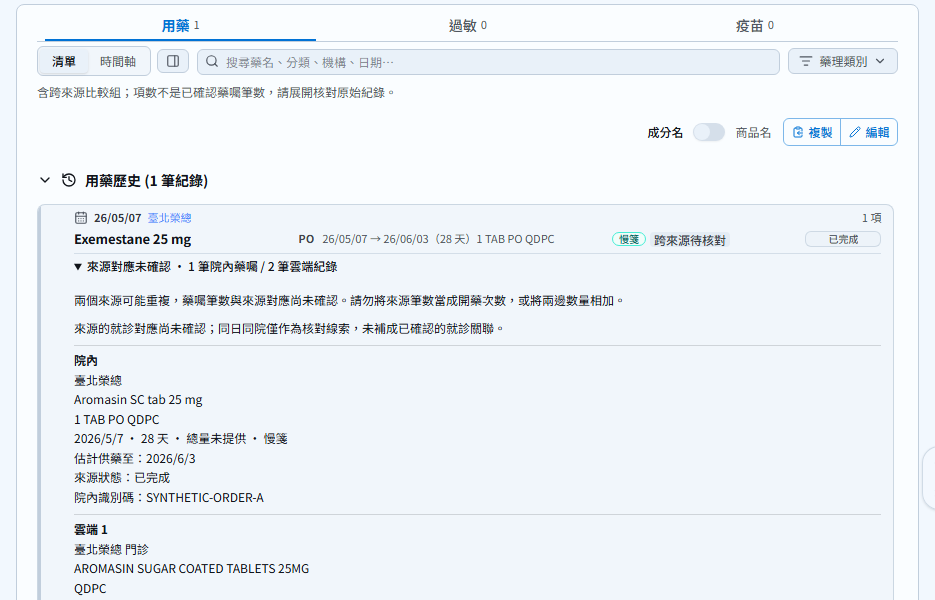
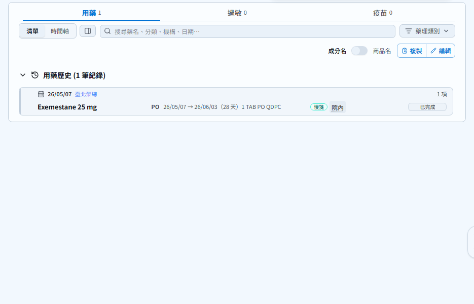
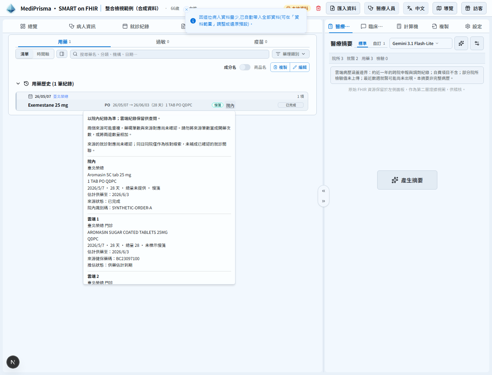

# 院內為主的緊湊用藥列

以同一份 `e2e/fixtures/cross-source-prescription-copies.json` 合成資料驗證，固定時間 2026-10-21，1440 × 1100 視窗、相同清單位置。沒有真實病人資料。

- Before：`cb25ef88e`，來源說明及三筆明細預設佔用清單空間。
- After：`339d51626432ae965cc4d768c7db475e33a28b49` 的 UI 程式，改成同列「院內」按鈕，點選後才開啟來源 Popover。
- 原始三筆資源保留，沒有新增已確認同一處方的宣告。可相容比較組的主列、日期、狀態與時間軸供藥期間採院內紀錄，雲端不覆蓋院內未知狀態，也不補造院內缺少的供藥期間。衝突來源、不同院內藥囑維持可分辨。

| Before | After |
| --- | --- |
|  |  |

已驗證：一組用藥保留 1 筆院內與 2 筆雲端；來源按鈕至少 24px、Popover 可用鍵盤開關及恢復焦點；320、390、430、768、1024、1440 寬度無橫向溢出。來源明細只在開啟後佔用浮層，不增加清單列。
