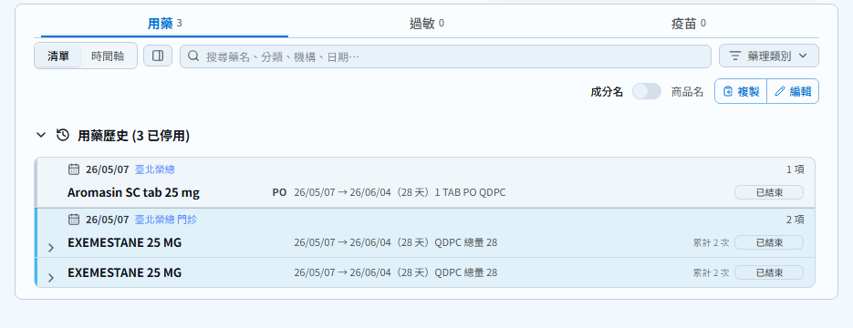
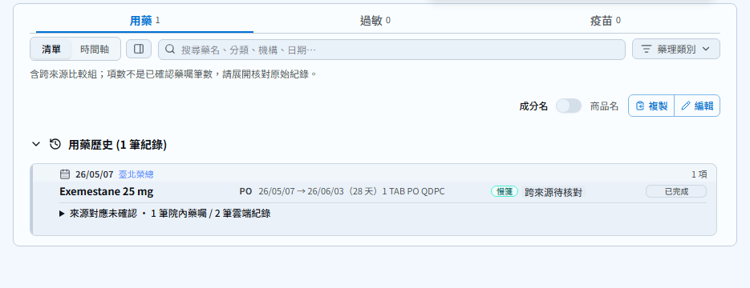
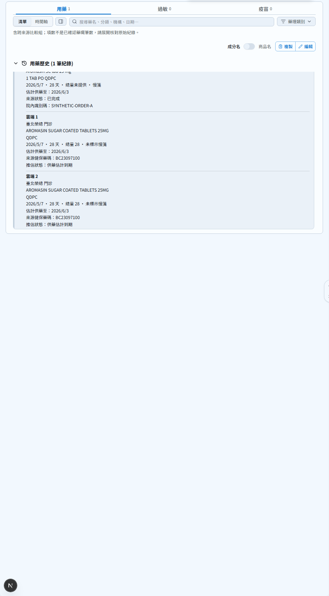

# Medication source comparison

All screenshots use the committed synthetic fixture
`e2e/fixtures/cross-source-prescription-copies.json`, a 1440 × 1100 browser
viewport, and 2026-10-21 as the fixed current date. The crops use the same
medication panel coordinates and 360-pixel height. No patient data is included.

- Before: `af0bfe42c50ecba16b62a58a35ba4808c79b472e`.
- After code: `17f72a0681d7e6df1b8ab83c29a75015a4cc6fff`.
- These screenshots document the medication list only. Later commits retain
  this list result; timeline and IPS changes are verified by the latest CI
  and their separate automated regression tests, not by these screenshots.
- Input: one hospital and two compatible MediCloud MedicationRequests dated
  May 7, with a 28-day supply. There is no shared prescription identifier.
- Expected list: one **unconfirmed comparison group**, retaining all three
  original records; the source record count is not a prescription count.
- Expected dates: inclusive supply through June 3, not June 4.

| Before | After |
| --- | --- |
|  |  |

The expanded view retains the original hospital SIG and both cloud quantities:

Automated coverage includes the real import-to-render flow, source inspection,
320/390/430/768/1024/1440-pixel widths, conflicting regimens and self-pay,
two distinct hospital orders, exact source dates, timeline intervals and
structured IPS source references. The raw FHIR export remains unchanged.
