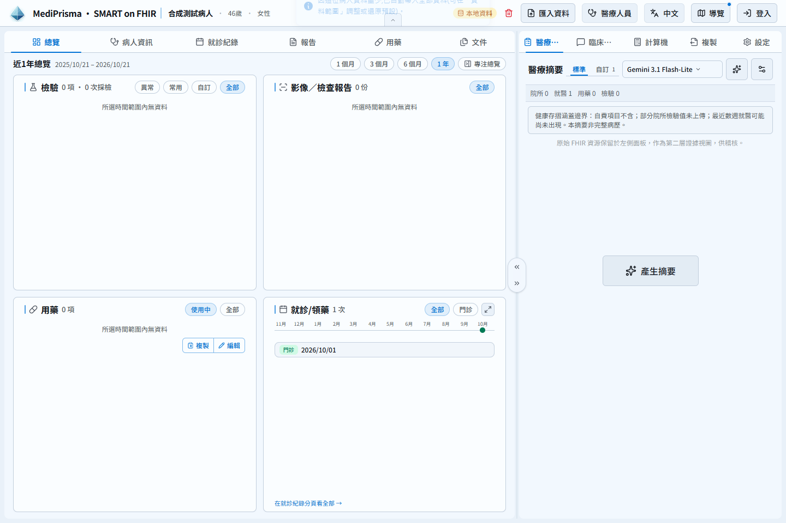
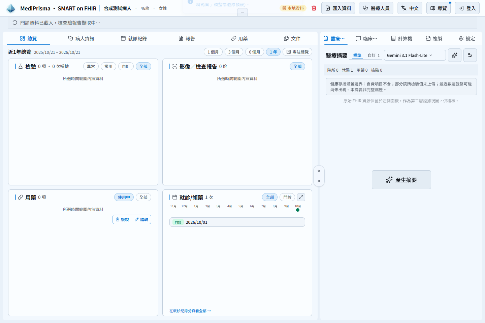
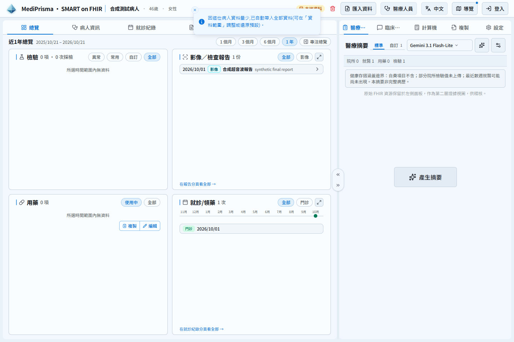
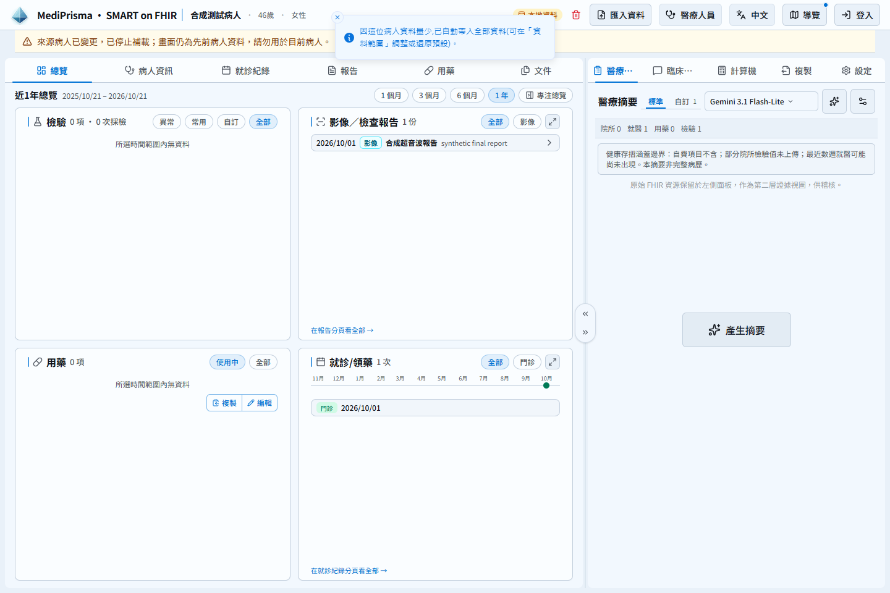

# Progressive outpatient import verification

- Base: 03442294087e623a113d9c4750cf5d16eacbb881 (0.51.0).
- Implementation reviewed and built: 89def08ce93a80c2d921c1e953da116de1846a7e (0.51.1). The evidence-only commit adds these files without runtime changes.
- All screenshots use the same synthetic patient, snapshot sequence, and 1440 × 960 viewport. Local production webpack export, isolated headless Chrome contexts, external requests blocked. Public synthetic Firebase values are used for QA only; this build must never be deployed.
- Before uses the base commit. It receives the same synthetic file inputs as manual imports because it does not advertise the progressive protocol. This is a UI comparison, not a claim that the old App supports three-stage extension negotiation.

## Observed behavior

| State | Base | Updated |
| --- | --- | --- |
| Cloud snapshot | No progressive status | Cloud loaded; outpatient capture pending |
| SOAP/resources snapshot | No progressive status | Outpatient data loaded; reports pending |
| Final reports | No progressive status | Hospital outpatient data loaded |
| Patient changes | No progressive warning | Keep prior chart with explicit patient-change warning |

| Base | Updated |
| --- | --- |
|  |  |
|  |  |

## Validation

The 149-test AI/provider/storage regression and 33 progressive importer/status tests cover terminal launch retirement, late credentials, generic recoverable failures, active automatic cancellation, completed-artifact retention, provisional preview rollback, and Bundle epoch isolation. The retained model-selection fallback only records settled artifacts; it does not preserve in-flight previews after cancellation.

The production-browser suite verifies cloud → SOAP → reports, stale replay rejection, different-patient rejection, raw FHIR graph uniqueness and download, images, cloned-tab source survival, quota rollback, and terminal warning persistence across reload. It also checks that replacing a same-patient snapshot closes an already-open stale report detail pane.

The compiled-injector simulation extracts startMediPrismaImport from the actual cloud extension build (0.15.9; exact SHA-256 recorded in compiled-injector.json) and exercises its DOM/receipt transport with this App. Runtime messaging is simulated in page world. This is not an installed-extension isolated-world or live HIS/card/patient E2E test. SOAP is visible before reports; replay and a different Patient are rejected. Status layout is checked at 320/390/430/768/1024/1440 pixels.

## Boundaries

- The extension verifies HIS identity; each progressive snapshot must preserve the initial cloud Patient.id and contain exactly one Patient. App checks this contract and its run/import ownership again.
- Snapshots replace the whole active graph, rather than append deltas. Failures/cancellation do not silently switch the durable pointer to memory-only data over a durable predecessor.
- Old encrypted scopes retain the existing 12-hour expiry so cloned tabs remain readable. Storage quota can therefore reject a replacement; the previous chart stays intact.
- A final accepted AI artifact is preserved on a later stop. In-flight previews are provisional; private entries in atomic multi-panel batches are not accepted until the batch commits. Explicit manual analysis remains available.
- No real patient data, credentials, or production AI calls are included in this evidence. Authorized-patient HIS/cloud E2E remains for the user.
- An earlier source revision fa8f325f passed 712 local suites / 9052 tests (1 suite / 1 test skipped). Latest-head GitHub CI is the full-suite gate.
- Production is deployed through the existing master CI → site synchronization workflow with production configuration, never from the local QA export.

Initial capture aborted before publication: the empty workspace displays a specific stop notice and no chart pointer is committed (initial-stop.json / after-initial-stop.png).
